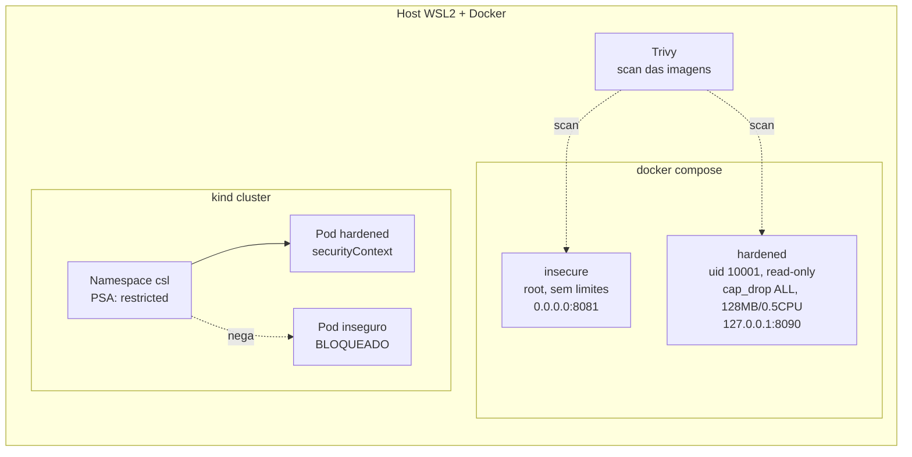

# Container Security Lab

Mini laboratório que compara um container **inseguro** com um **endurecido (hardened)** rodando o mesmo app Flask, com scan de vulnerabilidades (Trivy), Docker Compose e Kubernetes (kind).

## Resultado (Trivy, 05/11/2026, severidades HIGH+CRITICAL)

| Imagem | Base | CRITICAL | HIGH | Tamanho | Usuário |
|---|---|---|---|---|---|
| `csl-insecure` | `python:3.9` | **235** | **2402** | 1601 MB | root |
| `csl-hardened` | `python:3.12-slim` (multi-stage) | **0** | **46** | 187 MB | uid 10001 |

> O número de CVEs muda a cada dia (o banco do Trivy é atualizado). Rode `scripts/scan.sh` para gerar o seu. Os relatórios completos desta execução estão em `reports/`.
> Os 46 HIGH restantes são todos de pacotes Debian do SO, não do código Python. Próximo passo possível: distroless/Alpine.

## Arquitetura



## Hardening aplicado

| Controle | Inseguro | Hardened |
|---|---|---|
| Imagem base | `python:3.9` completa | `python:3.12-slim`, multi-stage |
| Usuário | root (uid 0) | uid 10001 não-root |
| Servidor | Flask dev server | gunicorn |
| Filesystem | gravável | `read_only` + `tmpfs /tmp` |
| Capabilities | padrão | `cap_drop: ALL` |
| Escalada de privilégio | permitida | `no-new-privileges` |
| Recursos | ilimitados | 128 MB, 0.5 CPU, 100 PIDs |
| Rede/porta | `0.0.0.0` | rede dedicada, `127.0.0.1` |
| Healthcheck | não | sim |

## Como rodar

```bash
# 1. Build
docker build -t csl-insecure:1.0 -f insecure/Dockerfile .
docker build -t csl-hardened:1.0 -f hardened/Dockerfile .

# 2. Scan (Trivy via container) -> reports/
./scripts/scan.sh

# 3. Compose
docker compose up -d
curl localhost:8081/   # insecure -> "uid":0
curl localhost:8090/   # hardened -> "uid":10001
docker compose exec hardened touch /app/x   # Read-only file system
docker compose down

# 4. Kubernetes (kind)
kind create cluster --name csl
kind load docker-image csl-hardened:1.0 csl-insecure:1.0 --name csl
kubectl apply -f k8s/namespace.yaml
kubectl -n csl apply -f k8s/deployment.yaml     # aceito
kubectl -n csl apply -f k8s/insecure-pod.yaml   # recusado pelo PSA
kind delete cluster --name csl
```

## Kubernetes e OpenShift

O namespace `csl` usa Pod Security Admission no nível `restricted`: o pod hardened (`runAsNonRoot`, `readOnlyRootFilesystem`, `allowPrivilegeEscalation: false`, `seccompProfile: RuntimeDefault`, `capabilities.drop: [ALL]`) é aceito, e o inseguro é recusado (veja `reports/k8s-insecure-blocked.txt`).

No OpenShift esse comportamento já vem por padrão: a SCC `restricted` (`restricted-v2`) impede rodar como root e atribui um UID aleatório do namespace. Por isso a imagem hardened é compatível com ele sem alterações.

## Estrutura

```
app/            Flask (/ e /health)
insecure/       Dockerfile inseguro
hardened/       Dockerfile endurecido
docker-compose.yml
k8s/            namespace (PSA), deployment, pod inseguro
scripts/scan.sh Trivy + tabela
reports/        saídas dos scans e do cluster
```
